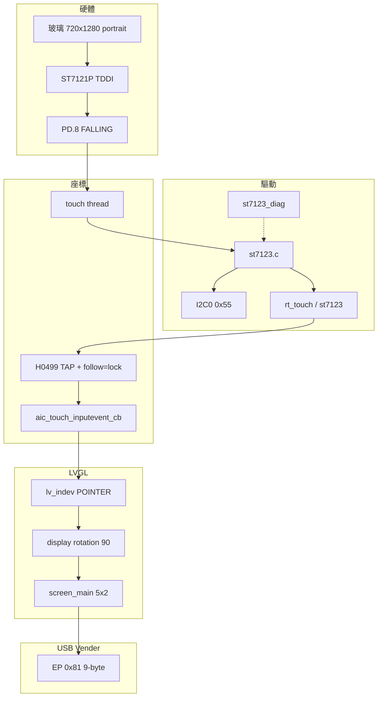

# Touch 功能說明（H0499 / ST7121P + LVGL 90°）

> **適用專案：** Luban-Lite RTOS SDK（D215 / 6K9901）+ `ui_builder`  
> **面板：** H0499S010 720×1280 MIPI 2-lane（TDDI ST7121P）  
> **觸控：** Sitronix ST7123 協定（I2C `0x55`，與 R520 ST7123P 共用驅動）  
> **UI：** LVGL v9，`LV_ROTATE_DEGREE=90`，邏輯畫面 **1280×720** landscape  
> **撰寫日期：** 2026-08-25  
> **現況：** 觸控拖曳已可接受；**請勿再改 TPC 對應公式**。串流重置屬獨立問題。

---

## 1. 目標與產品定位

本機當 USB 副屏／啟動器：

| 功能 | 畫面 | 觸控 |
|------|------|------|
| 開機 splash | `screen`（`AA 00`） | **關**（I2C 也暫停） |
| 應用啟動器 5×2 | `screen_main`（`AA 01`） | **開** — 點擊送 USB、長按拖曳換位 |
| JPEG/PNG 串流 | `screen_4_Area`（`AA 06`） | **關**（避免 TDDI I2C 與 GE 互搶導致類比凍結） |

設計原則：

1. **觸控只服務 `screen_main`。** splash / Area4 必須關 LVGL indev，並暫停 host I2C。
2. **圖示要黏在指尖。** 座標公式在 DOWN 鎖定（`follow=lock`），整段手勢不換公式。
3. **最右欄與跨排用放下判定補，不改 TPC。** 玻璃邊緣物理行程不足，改 `screen_main_slot_at_point()`。
4. **不要驅動 TP_RST 推挽高電位。** 3.3 V HIGH 會把 1.8 V 類比軌拉死；維持 Hi-Z + PU。

---

## 2. 硬體接腳（H0499 / CN4）

| 訊號 | GPIO | 功能 | 注意 |
|------|------|------|------|
| I2C SCL | PD.6 | I2C0 func4 + PU | `pinmux.c` / `st7123` 強制 remux |
| I2C SDA | PD.7 | I2C0 func4 + PU | 同上 |
| TP_INT | PD.8 | GPIO 輸入 + PU，**下降沿** | 禁止當輸出；低電位＝有報點 |
| TP_RST | PD.9 | **Hi-Z + PU**（開漏移位） | `H0499_TP_RST_MODE=0`；禁止反相 |
| LCD_RST | PD.13 | TFT RESX（經 level-shift） | 面板驅動擁有；觸控只讀 latch |
| I2C 位址 | — | `0x55`（7-bit） | 2-byte 暫存器位址，repeated-START |

對照 R520（非本板預設）：I2C3 PE.16/17、INT=PE.15、TP_RST=PE.14。

**致命錯誤（已踩過）：**

- 把 TP_RST 推挽拉高 → TDDI 類比不釋放。
- 把 INT 當輸出或反相 → 殺 TDDI。
- 開機就 probe I2C（LCD_RST 尚未完成）→ NACK / 凍結。
- splash / JPEG 期間持續讀 ADV_INFO + diag → 數分鐘後 `ADV_INFO fail`、`ctrl=0xff`、玻璃黑、觸控死。

開機 log 正常長相：

```
st7123: i2c xfer=poll-fifo-v2 pins=PD.6/PD.7
st7123: gpio TP_RST PD.9: func=1 OE=0 out_latch=0 pad=1
st7123: defer probe until panel ready (LCD_RST)
...
custom: touch OFF (screen_main only)
...
custom: recv AA 01, switch to screen_main
st7123: notify: I2C open (screen_main)
st7123: probe OK FW=1 rev=1.70.1.6 max=720x1280 touches=10 addr=0x55
```

---

## 3. 軟體架構



| 層 | 檔案 | 職責 |
|----|------|------|
| 面板時序 | `panel_dsi_h0499s010.c` | RESX 前後放 TP_RST Hi-Z；不在此開 I2C |
| TDDI 驅動 | `bsp/peripheral/touch/st7123/` | probe、讀報點、ghost 第二點、暫停 I2C |
| 輪詢執行緒 | `lv_tpc_run.c` | 8 ms soft-poll、TAP 對應、丟 `track_id != 0` |
| LVGL indev | `lv_port_indev.c` | 快取最後一點；`aic_touch_set_ui_enabled` |
| 總控 | `custom.c` `custom_touch_sync_to_screen()` | `AA 01` 開、其他畫面關 |
| 啟動器 | `screen_main.c` | 點擊 USB、長按拖曳、跨排／最右欄放下判定 |

執行緒（與觸控相關）：

| 名稱 | stack | 角色 |
|------|-------|------|
| `touch` | 4 KB | `tpc_run`：讀 `rt_touch` → TAP → indev |
| `st7123_diag` | 4 KB | 週期 STATUS / 統計；**串流時因 I2C pause 幾乎不做事** |
| `LVGL` | 48 KB | 事件、拖曳 timer 33 ms |

---

## 4. 三套座標系（必讀）

同一根手指在 log 會出現三組數字，名稱容易混。

```
實體玻璃（ST7123 報點）     720 寬 × 1280 高，portrait
        │
        │  map = (x, y)   例：FILES 約 (568, 80)
        ▼
90° 旋轉後的「邏輯 landscape」
        lx = 1280 - y - 1
        ly = x
        │
        │  [tpc] 欄位 lvgl=lx,ly   ← 這裡的 lvgl 不是 widget 座標
        ▼
TAP 三段 vis（DOWN 鎖定 mode）
        vis = (vx, vy)    vy 永遠 = ly
        │
        ▼
回寫給 LVGL indev 的「未旋轉 FB 空間」（720×1280）
        u16X = vy
        u16Y = 1280 - vx - 1
        │
        ▼
aic_touch_get_last_lvgl() 再做 LVGL 90°
        widget (X, Y) 落在 1280×720
```

`[tpc]` 一行解讀：

```
[tpc] DOWN id=0 map=568,80 lvgl=1199,568 vis=1199,568 mode=0 follow=lock
           │         │          │            │           │
           │      實體報點    旋轉後 lx,ly   TAP 後 vx,vy  DOWN 鎖定的公式
           事件
```

- `map`：晶片原始 `(x,y)`，範圍 720×1280。  
- `lvgl`：**旋轉後尚未 TAP** 的 `(lx,ly)`，不是 widget。  
- `vis`：TAP 後的視覺座標，對齊 5×2 格線。  
- `mode`：`0` FILES（右下）、`1` 上排、`2` 下排其餘。  
- `follow=lock`：整段手勢沿用 DOWN 的 mode，MOVE 不再重算。

`screen_main` 跟隨圖示時**必須**用 `aic_touch_get_last_lvgl()`，不可用 `last_x/last_y`（那是 portrait FB）。

---

## 5. TAP 對應與 `follow=lock`

檔案：`packages/artinchip/lvgl-ui/aic_drivers/lv_tpc_run.c`  
條件編譯：`AIC_TOUCH_PANEL_ST7123` + `AIC_PANEL_DSI_H0499S010` + `LV_ROTATE_DEGREE==90`

### 5.1 為什麼不能只做 90°

單純 `lx = 1280-y-1`、`ly = x` 後，上排最右 WORD 與下排最右 FILES 的 `lx` 會 wrap，點擊落在錯格。因此加 TAP：

| mode | DOWN 條件 | `vx` 公式 | 典型圖示 |
|------|-----------|-----------|----------|
| 1 | `ly < 360`（上半） | `lx - 256`，負則 `+1280` | LINE…WORD |
| 2 | `lx < 1024`（非最右） | `1023 - lx` | 下排左 4 顆 |
| 0 | 其餘（`lx ≥ 1024`） | `vx = lx` | FILES |

`vy = ly`（不改）。再轉回 indev：`u16X = vy`，`u16Y = 1280 - vx - 1`。

### 5.2 為什麼 MOVE 不可重算（`follow=lock`）

曾試過每筆 MOVE 依當下 `ly` 重選 mode。`ly=360` 是上／下公式交界，`vis_x` 會一次跳約 **500 px**。結果：

- 只有「左數第 2 顆」能跨排（剛好落在不跳的帶）。
- 其餘圖示一過中線就瞬移。

現行作法：**DOWN 鎖 mode，UP 才清 0。** 跨排不再靠換公式，改由 `screen_main` 的列滯後（見 §7）。

### 5.3 幽靈第二點

單指拖曳時 ST7123 常在 `y=1279` 再噴一顆 `track_id != 0`。若讓它進 TAP，會改 mode、LVGL X 變負。

雙層過濾：

1. `st7123.c`：H0499 只報 **slot 0**（仍 drain 其餘以清 INT）。  
2. `lv_tpc_run.c`：`track_id != 0` 直接 `continue`。

### 5.4 試過但已放棄的作法（勿重做）

| 嘗試 | 結果 |
|------|------|
| Jacobian 增益放大邊緣行程 | 圖示飛離指尖 |
| 拿掉 TAP（純 90°） | WORD / FILES 點錯格 |
| 每 MOVE 重算 TAP | 跨排 `vis_x` 跳 500 px |
| 改 TPC 硬拉最右欄 | 破壞黏指，回歸 lock + 放下判定 |

---

## 6. ST7123 驅動生命週期

檔案：`bsp/peripheral/touch/st7123/src/st7123.c`

### 6.1 開機

1. `INIT_DEVICE_EXPORT` 註冊 `st7123`，**不 probe**。  
2. GPIO：INT 輸入 PU + FALLING；TP_RST Hi-Z+PU。  
3. `tpc_run("st7123", 720, 1280)` 開裝置、建 `touch` 執行緒。  
4. 等 `panel_enable` 做完 RESX / MIPI video。  
5. 仍維持 `touch OFF`，直到 `AA 01`。

### 6.2 `AA 01` 才開 I2C

`custom_touch_sync_to_screen(0x01)`：

1. `aic_touch_set_ui_enabled(true)`  
2. `st7123_notify_panel_ready()`  
   - 第一次才 `claim` 腳位（之後不再 remux，避免 JPEG 回來後 GPIO 毛刺凍類比）  
   - 若已 probe：再等 **300 ms** 才准許 bus  
3. 首次讀 FW / max / sense_ramp；`WAS-SCANNING` 代表類比活著

### 6.3 離開 `screen_main` 暫停 I2C

`AA 00` / `AA 06`：

1. `aic_touch_set_ui_enabled(false)` — 丟事件、reset indev  
2. `st7123_pause_host_i2c()` — 類比繼續掃，**host 不 poll**

JPEG 期間若繼續讀 ADV／diag，曾在數分鐘內把 TDDI 讀死。

### 6.4 讀點策略

- INT 低：讀 ADV_INFO，再讀座標。  
- INT 高但手指仍 down：soft-poll（避免漏下降沿導致拖曳卡住）。  
- H0499 `burst_n = 1`（只取第一點）。  
- Idle 且無 down：連 ADV peek 都跳過。  
- 10 點 74-byte burst 在 I2C0 會 NACK，故不大包讀。

`touch` 執行緒對 ST7123：**semaphore 最多等 8 ms**，逾時仍讀一次（補漏沿）。

### 6.5 協定摘要

| 暫存器 | 意義 |
|--------|------|
| `0x0000` | FW version |
| `0x0001` | Status：`0x00` Normal、`0x04` Idle（都可掃） |
| `0x0002` | Device Control（RESET / POWER_DOWN） |
| `0x0005..08` | max X/Y |
| `0x000A/0B` | sense_cnt（遞增＝掃描中） |
| `0x0010` | ADV_INFO，bit2..5 有座標 |
| `0x0014` | touch0：7 bytes（X_H Valid=bit7，座標 hi mask `0x3F`） |

讀完整最後一點的最後一 byte 才清 INT。

---

## 7. `screen_main` 啟動器（觸控應用層）

檔案：`packages/artinchip/lvgl-ui/aic_demo/ui_builder/screen_main.c`  
邏輯解析度 1280×720，**5 欄 × 2 列**，每格約 **256×360**。

預設順序（slot 0..9）：

```
  0 LINE     1 OUTLOOK  2 EXCEL  3 PPT     4 WORD
  5 TEAMS    6 CHROME   7 EDGE   8 WECHAT  9 FILES
```

順序存 `/data/screen_main_order.bin`（magic `0x324D5301`）。

### 7.1 手勢

| 動作 | 行為 |
|------|------|
| 短按圖示 | `PRESSED` 立刻送 9-byte USB（不等 `SHORT_CLICKED`，因 INT 常黏低） |
| 長按 | 進 edit，拿起該圖示 |
| edit 中移動 ≥ 8 px | 開始拖曳 |
| 拖曳中 | 圖示中心 = 指尖 − grab；33 ms timer 跟隨 |
| 放開 ≥ 80 ms | commit 插入、存檔 |
| 短暫假 UP（< 80 ms） | 忽略（INT 抖動） |
| 假 UP 後新 DOWN 距圖示 > 300 px | 結束拖曳（防 WORD 在 y=1279 瞬移） |
| 點空白／再點圖示（未移動） | 離開 edit |
| 拖超過 30 s 仍按著 | 強制結束（緊急） |

Jiggle 動畫預設 **關閉**（`SCREEN_MAIN_USE_JIGGLE=0`），避免 edit 時 GE + I2C 過載。

### 7.2 跟隨（手機式 grab）

```
s_drag_grab = 指尖 - cell 左上
每幀：cell = 指尖 - grab
放下判定用 cell 中心 (cx, cy)
```

跟隨座標來自 `aic_touch_get_last_lvgl()`，與 widget 同一空間。

### 7.3 放下判定（補 TAP 的物理死角）

`screen_main_slot_at_point()`：

**跨排滯後 80 px**（硬切 360，實際放手 vis_y 常停在 336 或 383）：

- 從上排出發：`y ≥ cell_h - 80`（280）算下排  
- 從下排出發：`y < cell_h + 80`（440）算上排  

**最右欄（col 4，WORD / FILES）相對位移：**

玻璃邊把實體 Y 夾住，`vis_x` 往往只動約 80 px，絕對格線 `x/256` 離不開 slot 4。

- 相對起點中心 `s_drag_origin_cx` 往左 **40 px** 換鄰格  
- 之後每約 **2/3 cell** 再換一格  
- 左 4 欄維持絕對格線  

log：`screen_main: hover 9 -> 4` 代表目標格從 FILES 換成 WORD 那一欄的上排（依當下 row）。

---

## 8. USB 點擊封包

短按圖示 → `usbd_vender_send_ack_bytes()`，EP `0x81`，9 bytes：

```
FA FB FC  id  id  id  EC EB EA
```

| 應用 | id |
|------|----|
| LINE | `00` |
| Outlook | `01` |
| Excel | `02` |
| PowerPoint | `03` |
| Word | `04` |
| Teams | `05` |
| Chrome | `06` |
| Edge | `07` |
| WeChat | `08` |
| Files | `09` |

log：`screen_main: FILES press IN=0x81 ret=0 FA FB FC 09 09 09 EC EB EA`

---

## 9. 畫面與觸控開關

`custom_touch_sync_to_screen(cmd)`：

| cmd | 畫面 | LVGL 觸控 | ST7123 host I2C |
|-----|------|-----------|-----------------|
| `0x01` | `screen_main` | ON | open（首次 claim 腳位） |
| 其他 | splash / Area / Video | OFF | pause |

開機預設 OFF。未收到 `AA 01` 前，即使玻璃有觸摸也不進 LVGL。

---

## 10. UART log 速查

### 10.1 健康

```
st7123: probe OK FW=1 rev=1.70.1.6 max=720x1280 touches=10
st7123: post_notify sense_ramp => WAS-SCANNING
st7123: Status=0x04 (Idle)
st7123: TP_RST PD.9: func=1 OE=0 out_latch=0 pad=1
```

`FROZEN` 或 `OE=1 latch=0`（把 RST 拉低）才要查硬體。

### 10.2 拖曳一筆

```
st7123: touch DOWN id=0 x=568 y=80
[tpc] DOWN ... vis=1199,568 mode=0 follow=lock
screen_main: edit_mode=1
screen_main: drag begin app=9 from=9
screen_main: hover 9 -> 4
...
st7123: touch UP
screen_main: order saved
screen_main: drag end app=9 commit=1
```

### 10.3 可忽略的警告

| log | 意義 |
|-----|------|
| `read ADV_INFO fail, fail=1` | 單次 I2C 失敗，拖曳中偶發 |
| `H0499 WARM BOOT — GLASS WILL STAY BLACK` | WDT/USB 暖開，評觸控可以，評 panel 需 POR |
| `touch OFF (screen_main only)` | 預期：非啟動器畫面 |

### 10.4 與觸控無關的重置

長時間 Area4 串流後無 `ge timeout`、無 `DISPLAY STALL`、直接 Pre-Boot + HW WDT，是 GE/DDR silent hang，**不是觸控**。此時應為 `touch I2C paused`。

---

## 11. MSH 除錯指令

`st7123.c` 匯出（板子進 `aic />`）：

| 指令 | 用途 |
|------|------|
| `tp_rst` | 讀／pulse／float TP_RST；測 net 是否被拉死 |
| `tp_i2c_55` | 硬體 I2C 讀 STATUS |
| `tp_bb_55` | GPIO bitbang probe `0x55`（繞過控制器） |
| `tp_sda_tog` | 切 SDA pad，查 level-shift |

除錯完務必讓 TP_RST 回到 **Hi-Z + PU**。

---

## 12. 已知限制（2026-08 現況）

1. **最右欄實體行程短。** TAP lock 保證黏指；換格靠 40 px 相對位移，不是整格 256 px。  
2. **跨排靠 80 px 滯後。** 手指停在中線「視覺縫」也能換排；不是座標連續跨過 360。  
3. **單指。** 第二點丟棄；不做雙指縮放。  
4. **僅 `screen_main` 有 UI 觸控。** Area4 不能邊串流邊點。  
5. **暖開機玻璃可能全黑。** 觸控 log 仍可能正常；評顯示需拔 VCI/VDD 10 秒做 POR。  
6. **I2C 與 GE 互斥。** 這是 TDDI 實測結論，不是效能微調。

---

## 13. 相關檔案

| 路徑 | 內容 |
|------|------|
| `bsp/peripheral/touch/st7123/inc/st7123.h` | 暫存器、對外 API |
| `bsp/peripheral/touch/st7123/src/st7123.c` | 驅動、diag、MSH |
| `target/d21x/d215-demo88-nor-dacai03/pinmux.c` | PD.6/7/8/9 |
| `bsp/artinchip/drv/display/panel/panel_dsi_h0499s010.c` | RESX 與 TP_RST 時序 |
| `packages/artinchip/lvgl-ui/aic_drivers/lv_tpc_run.c` | TAP + lock |
| `packages/artinchip/lvgl-ui/lvgl_v9/lv_drivers/lv_port_indev.c` | indev、開關、旋轉座標 |
| `packages/artinchip/lvgl-ui/aic_demo/ui_builder/custom/custom.c` | `custom_touch_sync_to_screen` |
| `packages/artinchip/lvgl-ui/aic_demo/ui_builder/screen_main.c` | 5×2、拖曳、USB |
| `packages/artinchip/lvgl-ui/aic_demo/ui_builder/custom/custom_disp_profile.h` | 邏輯 1280×720 |

---

## 14. 維護備註

改觸控前先問：問題是「點錯格／不黏指」還是「放不下／跨不了排」？

- **點錯、飛離指尖** → 幾乎都是 TPC 公式；現行 lock 不要動。  
- **最右不能換格、跨排差一點** → 只動 `screen_main_slot_at_point()`。  
- **全無 DOWN、I2C fail 暴增** → 查 TP_RST / 是否在非 main 畫面開 I2C。  
- **串流中重置** → 看 `DDR_圖片顯示記憶體使用說明.md` 與 Area4，不要動觸控。
