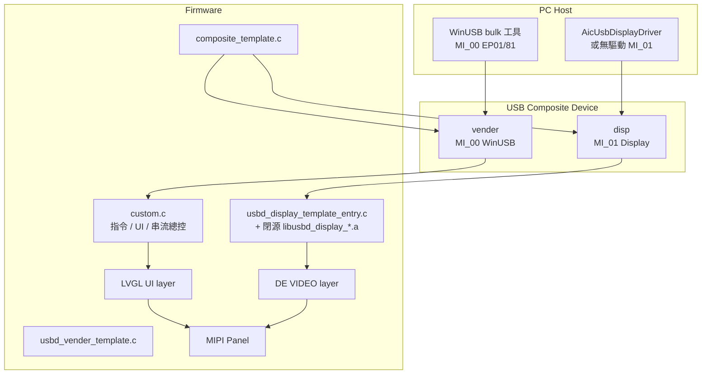

# USB Composite + USB Display 功能與修改歷程

> **適用專案：** Luban-Lite RTOS SDK（D215 / 6K9901）+ `ui_builder`  
> **面板範例：** FL7707N 9.2"（FB `462×1920`，PID `0xB305`）  
> **撰寫日期：** 2026-07-20  
> **相關 GitHub commit：**  
> - `f2cfea79` — *Add USB Display toggle with composite vender-first layout.*  
> - `0002adbb` — *Fix Area4 stream stall when PC skips AA 06.*（串流路徑；與 composite 並存）

---

## 1. 目標與產品定位

在同一條 USB 線上同時提供：

| 功能 | 介面 | 用途 |
|------|------|------|
| **Vender（WinUSB bulk）** | MI_00，EP `0x01` / `0x81` | PC 工具送 AA / CD-BB 圖檔串流、時間封包、BROM、USB Display 開關指令 |
| **USB Display（副屏）** | MI_01，EP `0x02` / `0x82` | PC 官方 / ArtInChip Display 路徑，把本機當擴充螢幕 |

設計原則：

1. **既有 PC bulk 工具不能壞** → Vender 必須保持 MI_00 + 固定 bulk EP。
2. **LVGL / Area4 串流與副屏可切換** → 用 12-byte 指令開關，不是開機就搶 framebuffer。
3. **閉源 Display 庫與開源 DE / LVGL 共存** → 需處理 FB 所有權、VIDEO layer `buf_type`、UI alpha。

---

## 2. 架構總覽



### 2.1 關鍵原始碼路徑

| 檔案 | 角色 |
|------|------|
| `packages/third-party/cherryusb/demo/composite_template.c` | Composite 組裝、VID/PID、功能順序、MS OS 2.0 / WinUSB、字串描述符 |
| `packages/third-party/cherryusb/demo/usbd_vender_template.c` | 單功能 / composite 下的 vender bulk；單功能時自帶 MS OS 2.0 |
| `packages/third-party/cherryusb/demo/usbd_display_template_entry.c` | Display 庫入口變數：`usb_display_en`、`usb_disp_free_framebuffer` 等 |
| `packages/artinchip/lvgl-ui/.../custom/custom.c` | 副屏 Enable/Disable 指令、暫停/恢復 CD-BB、UI alpha、延遲回 splash |
| `packages/artinchip/lvgl-ui/.../custom/custom.h` | `custom_usb_display_mode_is_active()` |
| `bsp/artinchip/drv/display/drv_de_vi_layer.c` | VIDEO layer：閉源庫 `buf_type` soft-fix |

閉源庫（menuconfig 啟用 Display 後連結）：

- `libusbd_display_template_c906fd.a`（提供 `usb_display_enable()` / `usb_display_disable()` 等）

---

## 3. 目前 Composite 行為（現狀說明）

### 3.1 VID / PID（ENE 面板編號）

```c
#define USBD_VID           0x0CF2
#if defined(AIC_PANEL_DSI_R520120T01)
#define USBD_PID           0xB304  /* ST7123 */
#elif defined(AIC_PANEL_DSI_FL7707_92IN)
#define USBD_PID           0xB305  /* FL7707N 9.2" */
#elif defined(AIC_DISP_LVDS)
#define USBD_PID           0xB306
#else
#define USBD_PID           0xB303
#endif
```

與單功能 `usbd_vender_template` 同一套 ENE PID，讓既有 WinUSB INF / PC 工具不用改。

### 3.2 功能載入順序（vender-first）

`g_func_table[]` 順序（與本專案相關）：

1. `vender` → **MI_00**，bulk EP `0x01` / `0x81`
2. `disp` → **MI_01**，bulk EP `0x02` / `0x82`

> 順序一反，PC 舊工具會開錯 interface / EP，圖檔串流會失效。

### 3.3 WinUSB / MS OS 2.0（只綁 vender）

Composite 模式由 `composite_template.c` 擁有 BOS + MS OS 2.0：

- `bcdUSB = 0x0210`（USB 2.1）→ Windows 才會查 BOS
- BOS 含 Microsoft OS 2.0 Platform Capability
- Descriptor Set 的 **Function Subset** 把 Compatible ID `WINUSB` 綁在 **vender 的 bFirstInterface**
- `bFirstInterface` 在 `usbd_composite_dev_load()` 後由 `comp_register_winusb()` runtime patch
- DeviceInterfaceGUID：`{1D4B2365-4749-48EA-B38A-7C6FDDDD7E26}`

開機 log 可見：

```text
[I/USB] COMP: WinUSB bound to vender intf 0
[I/USB] COMP: Composite device loaded.(2 - 2)
```

**Display（MI_01）不走 WinUSB MS OS；** 官方簽名驅動 `AicUsbDisplayDriver` 的 INF 只認 ArtInChip VID/PID（見第 6 節取捨）。

### 3.4 USB 字串

| 字串 | 內容 |
|------|------|
| iManufacturer | `"ENE "` |
| iProduct | `"ENE USB Device"` |

各 interface 節點在裝置管理員常顯示同一產品名；MI_01 若沒裝 Display 驅動，可能出現「無類別、無黃嘆號、Service 空白」，容易被誤認為「沒列舉到 Display」。

### 3.5 Display 預設關閉（與 LVGL 共存）

`usbd_display_template_entry.c`：

```c
#if defined(AIC_USB_DISP_DEF_DIS) || defined(LPKG_USING_LVGL)
uint8_t usb_display_en = 0;          /* 開機不啟用副屏 */
#endif

#if defined(AIC_LVGL_USB_OSD_DEMO) || defined(LPKG_USING_LVGL)
uint8_t usb_disp_free_framebuffer = 0; /* 不釋放 LVGL 正在用的 FB */
#endif
```

原因：開機若 `usb_display_en=1` 且釋放 framebuffer，會與 LVGL 搶 UI FB，曾導致 **CPU Exception NO.4**（mtval 像像素資料）。副屏改為 **執行期** 用指令開啟。

### 3.6 VIDEO layer soft-fix

閉源 Display 可能填好 `phy_addr[]` 卻把 `buf_type` 留在 `0`（`MPP_DMA_BUF_FD`）。RTOS DE 只接受 `MPP_PHY_ADDR`。

`drv_de_vi_layer.c` / `config_video_layer()`：

- 若 `buf_type != MPP_PHY_ADDR` 且 `phy_addr[0] != 0` → 強制改成 `MPP_PHY_ADDR`
- 否則報錯返回

沒有這段 soft-fix，副屏解碼後 VIDEO layer 可能配不上去。

---

## 4. 應用層：USB Display 開關指令

實作於 `custom.c`（所有 TFT 共用同一組 12-byte pattern）。

### 4.1 指令格式

| 動作 | 12 bytes（hex） |
|------|-----------------|
| **Enable**（進副屏） | `DE DF DA EF 11 44 66 23 EF DA DF DE` |
| **Disable**（回本地串流） | `DE DF DA EF 22 55 77 34 EF DA DF DE` |

對應 SDK：`usb_display_enable()` / `usb_display_disable()`。  
若未連結 Display 庫，走 `weak` stub；指令仍會切換本地「暫停/恢復串流」狀態。

### 4.2 接收路徑

`custom_recv_18bytes()`：

1. 整包 12-byte exact match → 立即 enter / exit  
2. 串流中亦用 byte-by-byte parser（`custom_feed_usbdisp_cmd_byte`）防分包  
3. **副屏模式中**：略過 AA / CD-BB 圖檔，只掃 disable / BROM / 時間封包  

### 4.3 Enable 行為（`custom_usbdisp_enter`）

1. 設 `s_usb_display_mode = 1`
2. 清 pending AA / 等待影像狀態
3. `custom_image_abort_recv()` 中止進行中的收圖
4. **UI layer alpha = 0（全透明）** → 露出 VIDEO layer 上的副屏畫面
5. 呼叫 `usb_display_enable()`
6. LVGL timer 在副屏期間 **直接 return**（不做 Area4 idle / pickup）

### 4.4 Disable 行為（`custom_usbdisp_exit`）

1. `usb_display_disable()`
2. **UI alpha = 0xFF（不透明）**
3. `s_usb_display_mode = 0`
4. 設 `s_usbdisp_pending_splash = 1`  
   → **下一輪 LVGL timer** 再 `custom_show_splash_screen()`  
   （避免在 USB RX 執行緒直接 invalidate 觸發 LVGL assert）

### 4.5 查詢 API

```c
/* custom.h */
uint8_t custom_usb_display_mode_is_active(void);  /* 1 = 副屏中，CD-BB 已暫停 */
```

---

## 5. 與 Area4 圖檔串流的關係

| 模式 | 畫面 | USB MI_00 資料 |
|------|------|----------------|
| 正常串流 | splash / `screen_4_Area` | AA、CD-BB JPEG/PNG |
| 副屏 | VIDEO layer 顯示 PC 桌面；UI 透明 | 僅控制指令有效；圖檔被略過 |

補充（同週期修復，見 commit `0002adbb`）：

- PC 常直接送 CD-BB **而不送 AA 06**。
- 若仍停在 splash，圖畫在非 active screen → `DRAW_POST_END` 不觸發 → back-pressure ~2 fps。
- 現況：第一張 Area4 圖會 **自動切到 `screen_4_Area`**（等同 AA 06）。
- 副屏模式（`s_usb_display_mode`）下 **不會** 做此自動切換。

---

## 6. Windows 驅動取捨（重要）

### 6.1 兩種 VID/PID 策略

| 策略 | VID/PID | Vender（bulk） | Display（副屏） |
|------|---------|----------------|-----------------|
| **A. 現行（ENE）** | `0x0CF2` / `0xB305`（FL7707） | WinUSB 自動綁 MI_00，PC 工具可用 | MI_01 **無**官方簽名驅動；裝置管理員可能「看起來沒事」但 Service 空白 |
| **B. 官方 Display** | `0x33C3` / `0x0E05` 等 | bulk 可能被擠到 MI_01，舊工具要改 | 簽名 `AicUsbDisplayDriver` 可綁定 |

官方 INF 大致只認：

- `USB\VID_33C3&PID_0E04`
- `USB\VID_33C3&PID_0E05&MI_00`（Display 當第一個 interface）

因此：**ENE PID + Display 在 MI_01 ≠ 官方驅動會自動裝上。**

### 6.2 曾嘗試的路徑

1. 改 composite 為官方 `33C3/0E05`、Display MI_00 → 副屏驅動 OK，bulk 工具需改 interface。  
2. 改回 **B305 + vender-first**（現行）→ 保證串流工具。  
3. 自製未簽名 `ENE_UsbDisplay` INF → `pnputil` / 一般安裝常因無數位簽章失敗；測試簽章環境也不穩定。

### 6.3 產品建議

- **以串流為主、副屏為輔：** 維持現行 A（`0CF2/B305` + vender MI_00）。副屏需另解驅動問題（簽 INF 或改 PC 軟體走 bulk 自繪）。  
- **以 Windows 擴充螢幕為主：** 考慮策略 B，並同步改 PC bulk 工具的 interface/EP。

---

## 7. 修改歷程（時間序）

### 階段 0 — 基線

- CherryUSB composite 框架可選載入 vender / display / MSC / CDC…
- 單功能 vender 已有 MS OS 2.0 → WinUSB
- `ui_builder` 走 LVGL + USB/UART 收圖（Area4 CD-BB）
- Display 閉源庫與 LVGL 同開時，開機易撞 FB

### 階段 1 — Composite 組裝與 WinUSB（進入 f2cfea79 前的開發）

| 項目 | 內容 |
|------|------|
| 功能表 | 啟用 `vender` + `disp` |
| 順序 | **vender 在前**，Display 在後 → MI_00 / MI_01 |
| MS OS 2.0 | 從「整機」改為 **Function Subset 只綁 vender** |
| bcdUSB | 2.1，確保 Windows 查 BOS |
| 字串 | Manufacturer / Product 改為 ENE 品牌 |

### 階段 2 — 開機崩潰修復

| 現象 | 原因 | 解法 |
|------|------|------|
| 開機 Exception NO.4 | Display 預設 enable + free FB，與 LVGL 搶 framebuffer | `usb_display_en=0`（有 LVGL 時）；`usb_disp_free_framebuffer=0` |
| VIDEO 無畫面 | 閉源庫 `buf_type=0` 但已填 `phy_addr` | `drv_de_vi_layer.c` soft-fix → `MPP_PHY_ADDR` |

### 階段 3 — 副屏執行期開關（custom.c）

| 項目 | 內容 |
|------|------|
| 指令 | 12-byte Enable / Disable（見 §4） |
| 串流 | Enable 時 abort / 暫停 AA·CD-BB；Disable 後恢復 |
| 顯示 | Enable：UI alpha=0；Disable：alpha=0xFF |
| 執行緒安全 | Disable 後 **延遲到 LVGL timer** 再回 splash |
| weak stub | 未連 Display 庫時指令仍能切本地狀態 |

### 階段 4 — VID/PID 來回與驅動現實

1. 為讓官方 Display 驅動綁定 → 試過 `33C3/0E05`、Display MI_00。  
2. 為保 PC bulk 工具 → **還原 ENE `0CF2` + 面板 PID（FL7707=`B305`）+ vender-first**。  
3. 未簽名 ENE Display INF 未能可靠安裝 → 現狀接受「bulk 優先、Display 驅動另解」。

### 階段 5 — 落地 commit

**`f2cfea79`**（2026-07-17）

> Add USB Display toggle with composite vender-first layout.  
> Enable/disable secondary screen via 12-byte USB cmds, keep WinUSB bulk on MI_00, soften LVGL FB ownership and video-layer buf_type so Display can share the panel with ui_builder.

主要改動檔：

- `composite_template.c`
- `usbd_display_template_entry.c`
- `custom.c` / `custom.h`
- `drv_de_vi_layer.c`
- CherryUSB `Kconfig` / 相關 defconfig

**`0002adbb`**（2026-07-20）

> Fix Area4 stream stall when PC skips AA 06.

與 composite 並行：第一張 Area4 圖自動切 `screen_4_Area`，避免無 AA 06 時 ~2 fps / 無反應（副屏模式除外）。

---

## 8. 操作與驗證清單

### 8.1 開機預期 log（節錄）

```text
[I/USB] ----- USB display config: -----
[I/USB]  LCD width = 462
[I/USB]  LCD height = 1920
...
[I/USB] COMP: Add device class: vender
[I/USB] COMP: Add device class: disp
[I/USB] COMP: WinUSB bound to vender intf 0
[I/USB] COMP: Composite device loaded.(2 - 2)
[I/USB] Open ep:0x01 ...
[I/USB] Open ep:0x81 ...
[I/USB] Open ep:0x82 ...
[I/USB] Open ep:0x02 ...
```

### 8.2 驗證項目

| # | 項目 | 預期 |
|---|------|------|
| 1 | PC 用 WinUSB 開 MI_00 / EP01·81 | 可送 AA / CD-BB，Area4 有畫面（約 20 fps） |
| 2 | 不送 AA 06 直接 CD-BB | 自動切 `screen_4_Area`，不卡在 2 fps |
| 3 | 送 Enable 12-byte | log：`USB Display ENABLE`；UI 透明；串流暫停 |
| 4 | 送 Disable 12-byte | log：`USB Display DISABLE`；回 splash；可再串流 |
| 5 | USBTreeView | MI_00 = WinUSB；MI_01 = Display 或無服務節點 |
| 6 | 長時間串流 | 無 Exception NO.4；WDT 無無故重啟 |

### 8.3 PC 端送指令注意

- 走 **vender WinUSB bulk OUT**（不是 Display interface）。
- Enable/Disable 建議整包 12 bytes 一次送完；firmware 也支援 byte stream 拼接。
- 副屏開啟期間不要指望 CD-BB 還會更新 LVGL 畫面。

---

## 9. menuconfig / 編譯注意

與本功能相關的典型選項（名稱以實際 Kconfig 為準）：

- `LPKG_CHERRYUSB_DEVICE_COMPOSITE`（或專案對應 composite 入口）
- `LPKG_CHERRYUSB_DEVICE_VENDER_TEMPLATE`
- `LPKG_CHERRYUSB_DEVICE_DISPLAY`
- `LPKG_USING_LVGL` / ui_builder demo
- 面板：`AIC_PANEL_DSI_FL7707_92IN` → PID `B305`
- 建議：`AIC_USB_DISP_DEF_DIS`（預設 Display off；有 LVGL 時 entry 已強制 off）

重建後請確認：

1. Composite 兩個 class 都 loaded  
2. `WinUSB bound to vender intf 0`  
3. 未再出現開機 Exception NO.4  

---

## 10. 已知限制與後續

| 項目 | 說明 |
|------|------|
| Display 驅動 | ENE VID/PID + MI_01 無法直接用官方簽名 INF |
| 未簽名 INF | 一般 Windows 無法安裝；需正式簽章或測試模式策略 |
| 閉源庫行為 | `buf_type` / enable 時序依賴 soft-fix 與預設 off |
| 雙模式互斥 | 副屏與 Area4 串流不同時顯示；切換靠 12-byte 指令 |
| FPS | Area4 走 LVGL widget 路徑，D215 V10 實務約 20–25 fps（見 Area4 相關 Note） |

**可能後續方向：**

1. 取得 ENE `VID_0CF2&PID_B305&MI_01` 的簽名 Display INF  
2. 或產品分 SKU：串流版（ENE PID）/ 副屏版（官方 PID）  
3. 或 PC 端副屏改走 vender bulk 自研協定（不依賴 AicUsbDisplayDriver）

---

## 11. 相關文件

| 文件 | 內容 |
|------|------|
| `Note/custom_流程說明.md` | custom.c 總控、AA / 畫面切換 |
| `Note/custom_Image_流程說明.md` | USB 收圖緩衝 |
| `Note/DDR_圖片顯示記憶體使用說明.md` | CMA / 串流記憶體 |
| SDK：`usb_display_enable` / `usb_display_disable` | 閉源 Display API |
| GitHub：`difgor04262002/Luban-Lite_RTOS_SDK_D215-master` | 正式推送 repo（工作目錄 D215-master 可能尚未做完整 git commit） |

---

## 12. 快速對照表（給維運 / FAE）

| 問題 | 先查 |
|------|------|
| PC 工具打不開裝置 | VID/PID 是否 `0CF2/B3xx`？WinUSB 是否綁 MI_00？ |
| 有收包無畫面、~2 fps | 是否缺 AA 06？（現已 auto-switch）；是否卡在 splash？ |
| 副屏全黑 | Enable 有無送出？UI alpha 是否 0？VIDEO `buf_type` soft-fix 是否在？ |
| 開機就 Exception 4 | `usb_display_en` / `usb_disp_free_framebuffer` 是否被改回 1？ |
| 裝置管理員看不到 Display | MI_01 可能無驅動仍列舉；用 USBTreeView 看 interface，勿只看「有黃嘆號」 |
| 官方副屏軟體認不到 | 現行 ENE PID 本來就不在官方 INF 內（見 §6） |

---

*本文件描述截至 2026-07-20 工作區與 GitHub `main`（含 `f2cfea79` / `0002adbb`）的 composite + USB Display 狀態。若後續改 VID/PID 或 interface 順序，請同步更新 §3、§6、§7。*
