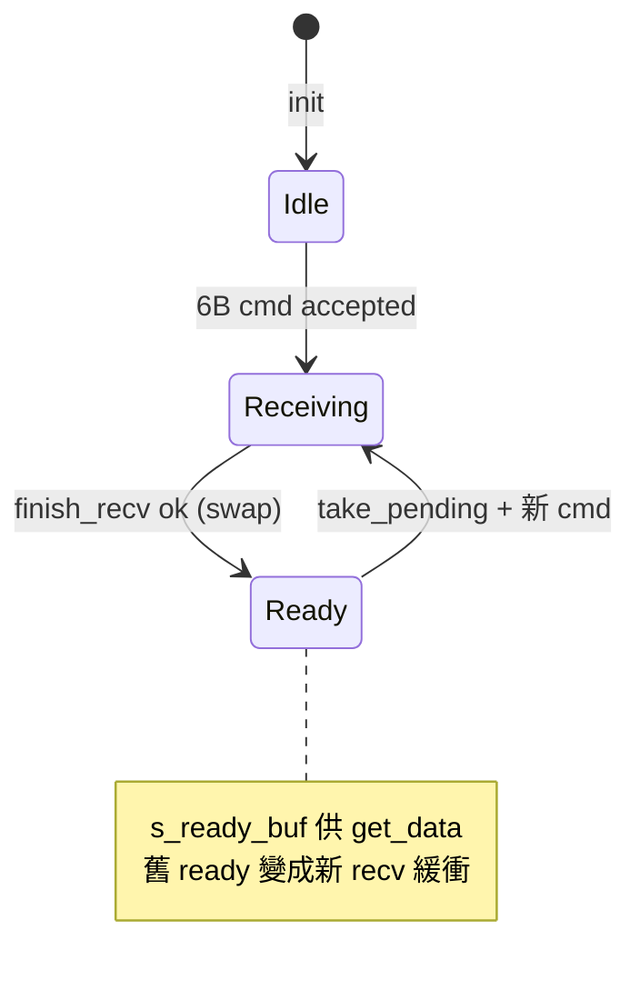
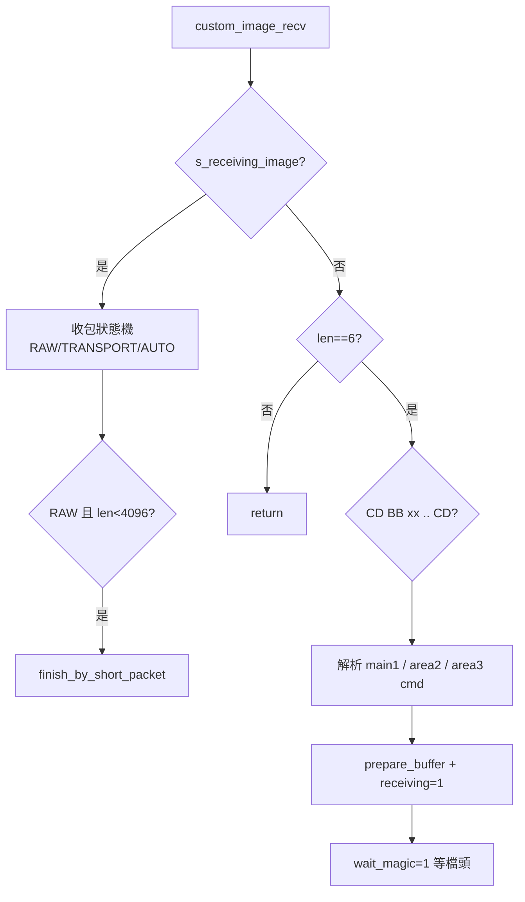
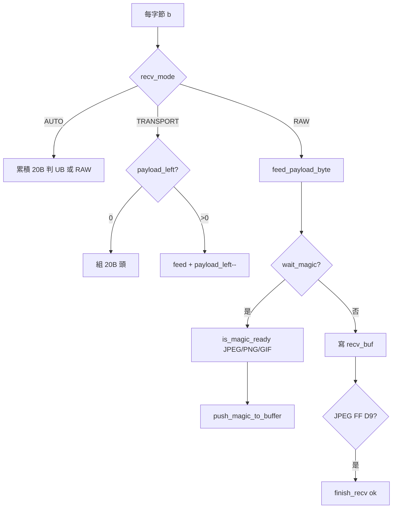
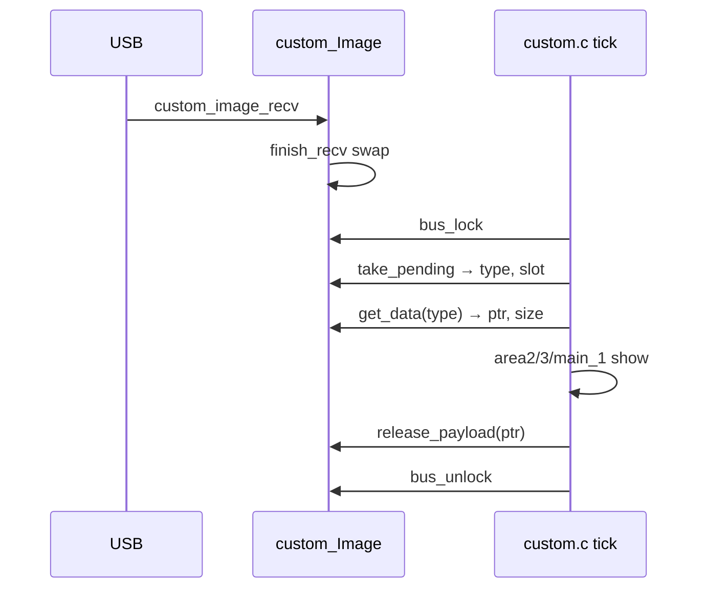

# custom_Image.c 模組說明

> **檔案：** `custom/custom_Image.c`（約 802 行）  
> **標頭：** `custom_Image.h`  
> **角色：** USB 影像 **接收層**（緩衝、組包、完成判定），不負責 LVGL 繪製  
> **上層：** `custom.c`（tick 取圖顯示）、`custom_Area2/3.c`（消費資料）

---

## 1. 模組概述

`custom_Image` 將 PC 下傳的影像位元組累積到 **recv 緩衝**，收完後透過 **指標交換（swap）** 移交給 **ready 緩衝**，由 LVGL tick 透過 `take_pending` / `get_data` 讀取並顯示。

| 項目 | 說明 |
|------|------|
| 最大影像 | 8 MiB（`CUSTOM_IMAGE_MAX_SIZE`） |
| USB 分包 | 滿包 4096B；**短包** 作 PNG/GIF/APNG 結束 |
| 接收模式 | RAW（magic 對齊）/ TRANSPORT（20B UB 頭）/ AUTO |
| 執行緒安全 | `bus_lock` / `bus_unlock`（RT-Thread mutex） |

---

## 2. 緩衝區模型（雙緩衝交換）



| 緩衝 | 用途 |
|------|------|
| `s_recv_buf` | 正在累積的影像 |
| `s_ready_buf` | 已完成、待 UI 讀取 |
| swap 後 | 避免大 PNG 結束時再 memcpy 一整塊 |

---

## 3. 主流程圖

### 3.1 `custom_image_recv` 頂層分派



### 3.2 收包狀態機（`s_receiving_image`）



### 3.3 UI 消費流程（與 `custom.c` 協作）



---

## 4. 公開 API 函式說明

| 函式 | 功能 |
|------|------|
| `custom_image_init` | 初始化 mutex、清零狀態、`malloc` 初始 recv 緩衝（128KB） |
| `custom_image_bus_lock` | 取得匯流排鎖（recv 與 show 互斥） |
| `custom_image_bus_unlock` | 釋放匯流排鎖 |
| `custom_image_recv` | **USB 入口**：6B 指令或影像 payload |
| `custom_image_take_pending` | 取走並清除 `pending` 類型與槽位（tick 每輪一次） |
| `custom_image_get_data` | 依類型取得 `ready` 緩衝指標與長度 |
| `custom_image_release_ready` | 釋放 `ready` 緩衝（free） |
| `custom_image_release_payload` | 釋放指定指標（ready 或 swap 後的舊 recv） |
| `custom_image_resync_wait` | UI 等待類型與 ready 不一致時對齊 slot/type |

---

## 5. 內部 static 函式說明

| 函式 | 功能 |
|------|------|
| `custom_image_is_transport_header20` | 驗證 20 字節 UB 頭（55 42、payload 長度合法） |
| `custom_image_parse_u32_be` | 大端 32 位解析 |
| `custom_image_prepare_buffer` | 確保 recv 緩衝至少 128KB |
| `custom_image_ensure_capacity` | recv 緩衝按需 2 倍擴容 |
| `custom_image_ensure_ready_capacity` | ready 緩衝擴容（較少使用，多靠 swap） |
| `custom_image_finish_recv` | 成功則 swap；失敗則清狀態 |
| `custom_image_check_eof` | JPEG 檢測 `FF D9` 結尾（PNG 不用 IEND 掃描） |
| `custom_image_finish_by_short_packet` | USB 短包結束 PNG/GIF/APNG |
| `custom_image_finish_gif_by_short_packet` | GIF 專用短包結束 |
| `custom_image_is_magic_ready` | 滑動窗口識別 JPEG/PNG/GIF 魔數 |
| `custom_image_push_magic_to_buffer` | 魔數確認後寫入 recv |
| `custom_image_feed_payload_byte` | 單字節寫入並檢查結束條件 |

---

## 6. 指令格式

### 6.1 main_1（`CD BB 02`）

| 偏移 | 含義 |
|------|------|
| 2 | `0x02` |
| 3 | 類型：JPEG/PNG/GIF/APNG |
| 4 | 槽：`0x01`~`0x03` → image_1~3 |

### 6.2 Area2（`CD BB 04`）

由 `custom_area2_try_parse_cmd` 解析（見 Area2 文件）。

### 6.3 Area3（`CD BB 05`）

由 `custom_area3_try_parse_cmd` 解析；`custom_image_recv` 將 type 正規化到 byte3。

---

## 7. 結束傳輸判定

| 類型 | 結束方式 |
|------|----------|
| JPEG | 掃描 `FF D9`（`check_eof`） |
| PNG / APNG | **僅** USB 短包（`< 4096`），不掃 IEND（避免 IDAT 內假 IEND） |
| GIF | USB 短包；不單靠 `0x3B` 截斷 |
| TRANSPORT | UB type `0x02` 空載荷或 20B 頭 payload=0 |

---

## 8. 重要狀態變數

| 變數 | 含義 |
|------|------|
| `s_pending_img_type` / `s_pending_img_slot` | 待 tick 顯示 |
| `s_req_img_type` / `s_recv_img_type` | 請求類型 / 實際檢測類型 |
| `s_receiving_image` | 正在收包 |
| `s_recv_size` / `s_ready_size` | 當前累積/已完成大小 |
| `s_recv_mode` | RAW / TRANSPORT / AUTO |
| `s_wait_magic` | 尚未看到檔頭魔數 |
| `s_img_payload_left` | TRANSPORT 模式剩餘 payload |

---

## 9. 設計要點與陷阱

1. **swap 後勿立即 free 舊 recv**：可能仍被 LVGL 解碼中，用 `release_payload` 釋放。  
2. **收包中丟棄嵌套 6B cmd**：避免打斷當前影像。  
3. **18B AA 監控幀**：收圖時若偵測到則 drop，避免污染 MP4/影像。  
4. **`release_ready` vs `release_payload`**：顯示完成後應傳入 `get_data` 回傳的指標。

---

## 10. 相依關係

```
custom_Image.c
  ├── custom_Area2.h / custom_Area3.h  (try_parse_cmd)
  ├── CherryUSB vendor → custom_recv_18bytes → custom_image_recv
  └── custom.c custom_screen_switch_timer_cb
```

---

*依 `custom_Image.c` 現行實作整理。*
