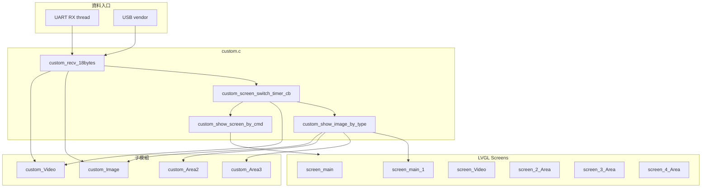
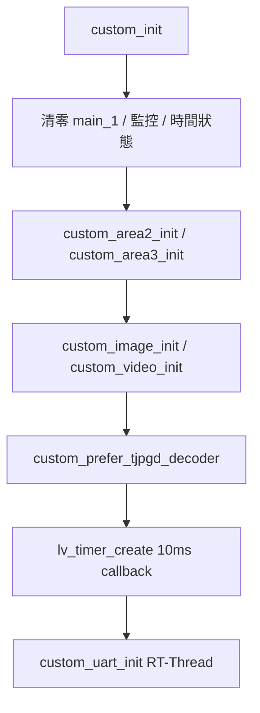
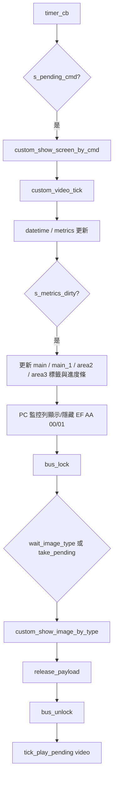
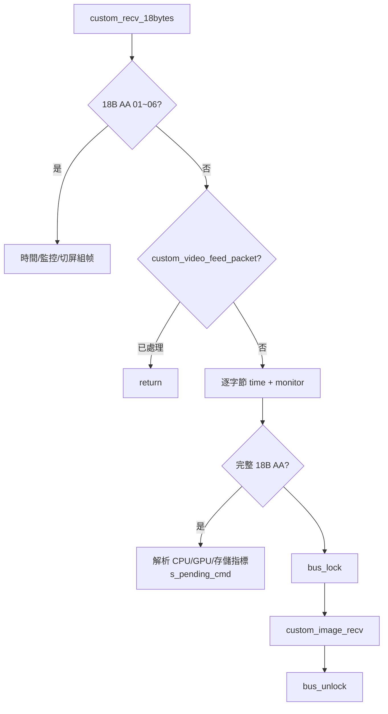
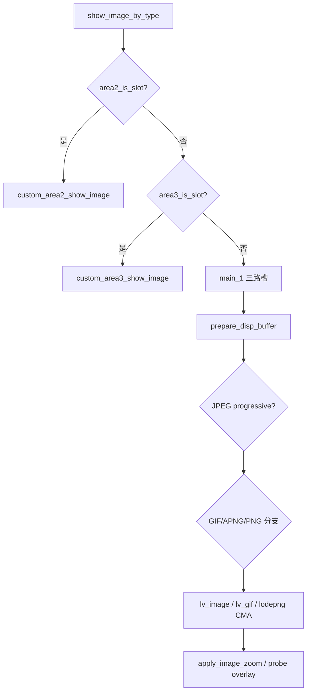
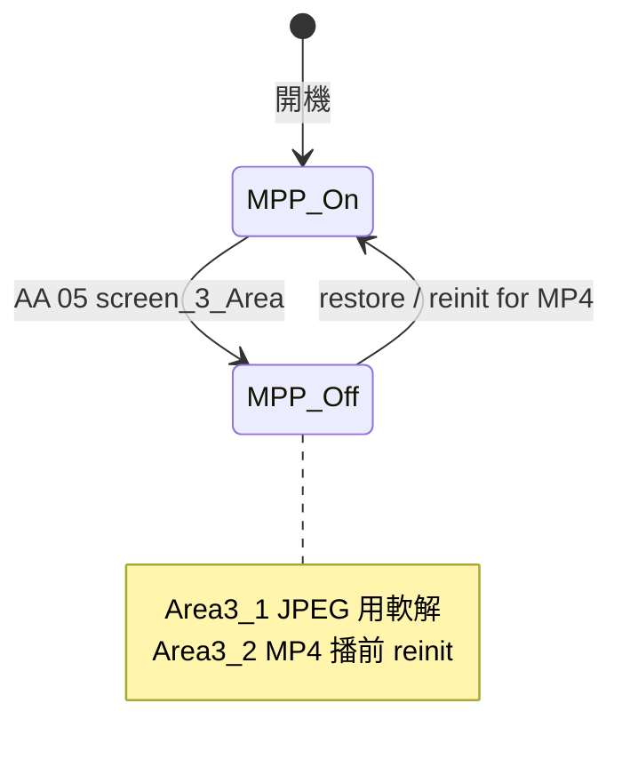

# custom.c 模組說明

> **此檔已過期（仍寫 Area2 / Area3 / Video，行數也不符）。**  
> D125 / ZC-T1D8BP 請改看：[`D125/D125_custom.c說明.md`](D125/D125_custom.c說明.md)

> **檔案：** `custom/custom.c`  
> **標頭：** `custom/custom.h`  
> **角色：** UI 應用 **總控** — 畫面切換、18 字節監控、影像顯示分派（Area2/Video 已於 2026-06-16 移除）

---

## 1. 模組概述

`custom.c` 是 Luban-Lite UI Demo 的 **自訂邏輯中心**，串接：

| 子模組 | 職責 |
|--------|------|
| `custom_Image` | USB 收圖緩衝 |
| `custom_Area2` / `custom_Area3` | Area 畫面顯示 |
| `custom_Video` | 全螢幕 / Area3 MP4 |
| `screen_*` | UIBuilder 生成的 LVGL 畫面 |

**週期任務：** `lv_timer` 10ms → `custom_screen_switch_timer_cb`（切屏、video tick、監控、顯示待處理圖像）。

**資料入口：** UART 或 USB → `custom_recv_18bytes` → 分派 video / image / 18B 監控。

---

## 2. 系統架構



---

## 3. 初始化與週期流程

### 3.1 `custom_init`



### 3.2 `custom_screen_switch_timer_cb`（每 10ms）



---

## 4. `custom_recv_18bytes` 分派



**注意：** 完整 18 字節 `AA 01~06` 用於切屏與監控；視頻/影像 bulk 走 `custom_video_feed_packet` 或 `custom_image_recv`，避免混流破壞 MP4。

---

## 5. 畫面切換 `custom_show_screen_by_cmd`

| cmd (`AA xx`) | 畫面 | 特殊處理 |
|---------------|------|----------|
| `0x01` | `screen_main` | — |
| `0x02` | `screen_main_1` | 三圖槽 main_1 |
| `0x03` | `screen_Video` | 全螢幕 USB 視頻 |
| `0x04` | `screen_2_Area` | Area2 圖 |
| `0x05` | `screen_3_Area` | Area3；**lv_mpp_dec_deinit**（JPEG 軟解） |
| `0x06` | `screen_4_Area` | — |


---

## 6. 影像顯示 `custom_show_image_by_type`



**main_1 專有邏輯：**

- Progressive JPEG 拒絕（硬解不支援）  
- PNG 可選 lodepng 軟解 + CMA  
- GIF/APNG 使用 `lv_gif` 或記憶體路徑  
- `custom_disable_mpp_decoder_once` 與 Area3 類似策略  

---

## 7. 公開 API（`custom.h`）

| 函式 | 功能 |
|------|------|
| `custom_init` | 應用啟動時呼叫一次，建立 timer 與子模組 |
| `custom_recv_18bytes` | 所有 UART/USB 字節的統一入口 |
| `custom_ui_wake_tick_timer` | `lv_timer_ready` 盡快執行 tick（video ACK 等） |
| `custom_ui_restore_lv_mpp_dec_if_needed` | AA05 後若曾 deinit，播 MP4 前恢復 MPP |
| `custom_ui_reinit_lv_mpp_dec_for_area3_mp4` | Area3 MP4 播放前強制 deinit+init MPP |

---

## 8. 函式分類表（static + 主要邏輯）

### 8.1 日期時間

| 函式 | 功能 |
|------|------|
| `custom_is_leap_year` | 閏年判斷 |
| `custom_days_in_month` | 每月天數 |
| `custom_datetime_is_valid` | 日期合法性 |
| `custom_datetime_tick_one_second` | 每秒遞增時鐘 |
| `custom_datetime_set` | 設定初始日期時間 |
| `custom_datetime_update_running` | tick 驅動時鐘走動 |
| `custom_update_screen_datetime_label` | 刷新各畫面日期標籤 |
| `custom_feed_time_frame_byte` | 組 10 字節 PC 時間幀 |

### 8.2 PC 監控（18 字節 + EF AA）

| 函式 | 功能 |
|------|------|
| `custom_feed_monitor_cmd_byte` | 識別 `EF AA 00 EF` 開始 / `EF AA 01 EF` 停止監控 |
| timer 內邏輯 | 控制 Area2/Area3 CPU 頻率/使用率控件顯隱 |

**18 字節 `AA` 幀佈局（byte2 起）：** CPU 頻率、使用率、GPU、溫度、存儲、RAM 等（見 `custom_recv_18bytes` 解析）。

### 8.3 影像格式輔助（main_1）

| 函式 | 功能 |
|------|------|
| `custom_is_image_src_ready` | LVGL 解碼器能否識別 src |
| `custom_jpeg_is_progressive` | 是否漸進式 JPEG |
| `custom_jpeg_get_size` | 解析 JPEG 尺寸 |
| `custom_gif_header_valid` | GIF 頭合法 |
| `custom_gif_calc_fps_x10` | GIF 幀率估算 |
| `custom_png_get_color_type` | PNG 色型 |
| `custom_png_get_size` | PNG 尺寸 |
| `custom_apng_to_static_png` | APNG 轉靜態 PNG（可選） |
| `custom_prefer_tjpgd_decoder` | 偏好 TJPGD |
| `custom_disable_mpp_decoder_once` | 關閉 MPP 解碼器一次 |
| `custom_calc_zoom_from_src` | 計算縮放比例 |
| `custom_apply_image_zoom` | 套用 zoom 到 image |
| `custom_prepare_disp_buffer` | main_1 槽位拷貝 |
| `custom_prepare_gif_buffer` | main_1 GIF 緩衝 |
| `custom_show_probe_overlay` | 探測用覆蓋層 |
| `custom_probe_timer_cb` | 探測定時器 |

### 8.4 UART（RT-Thread）

| 函式 | 功能 |
|------|------|
| `custom_find_uart_device` | 查找可用 UART 設備名 |
| `custom_uart_rx_ind` | RX 中斷釋放信號量 |
| `custom_uart_rx_thread` | 讀字節並呼叫 `custom_recv_18bytes` |
| `custom_uart_init` | 打開 UART、建立線程 |

---

## 9. 18 字節監控幀（`CUSTOM_FRAME_LEN = 18`）

| 用途 | 條件 |
|------|------|
| 切換畫面 | `data[0]==0xAA`, `data[1]` 為 `0x01`~`0x06` |
| 更新指標 | 同一幀內解析 CPU/GPU/存儲等 |
| 與 Video 分離 | 必須整幀 18B；否則可能誤入 `custom_video_feed_packet` |

---

## 10. 影像顯示等待機制

| 變數 | 含義 |
|------|------|
| `s_wait_image_type` / `s_wait_image_slot` | 已 take_pending，等待顯示的類型/槽 |
| `custom_image_resync_wait` | USB 又完成新圖時，對齊 wait 與 ready |
| `custom_image_release_payload` | 顯示後釋放正確 heap 塊 |

tick 內順序：`take_pending` → 若無則用 `wait_*` → `get_data` → `show` → `release_payload`。

---

## 11. MPP 解碼器策略（LVGL9）



---

## 12. 檔案相依

```
custom.c
  ├── custom.h
  ├── custom_Image.h / custom_Video.h
  ├── custom_Area2.h / custom_Area3.h
  ├── ui_objects.h (所有 screen_*)
  ├── lv_aic_player.h
  └── lv_mpp_dec / lodepng (LVGL9)
```

---

## 13. 相關文檔

同目錄下另有：

- `custom_Image_流程說明.md` — USB 收圖細節  
- `custom_Area2_流程說明.md` / `custom_Area3_流程說明.md` — 分區顯示  
- `../screen_Video_流程說明.md` — Video 畫面控件  
- `custom_Video_流程說明.md` — MP4 串流（若已建立）

---

*依 `custom.c` 現行實作整理。*
